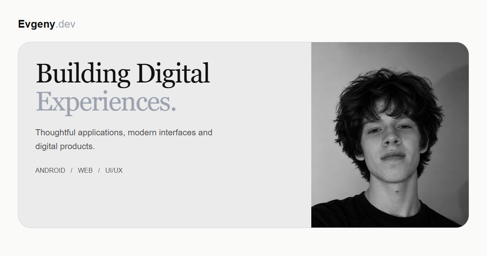

<div align="center">

# Evgeny.dev

**Личное портфолио разработчика · Android / Web / UI & UX**

Приложения, интерфейсы и цифровые продукты, в которых сложное становится простым.

[Русский](README.md) · [English](README.en.md) · [Документация](docs/DEVELOPMENT.md) · [Связаться](https://t.me/moii_telega)




</div>

## О проекте

Портфолио Евгения с авторскими обложками проектов, живым каталогом GitHub и интерактивным терминалом. Монохромная палитра, выразительная типографика и плавное движение объединяют проекты, стек и историю разработчика.

Сайт работает как статическое приложение: для запуска не нужны backend и API-ключи.

## Что внутри

| | Возможности |
| :--- | :--- |
| **Проекты** | Каталог с фильтрами, подробными карточками и синхронизацией с GitHub. При недоступности API используются кеш или локальные данные. |
| **Два языка** | Русский и английский, определение языка браузера и сохранение ручного выбора. |
| **Движение** | GSAP, Motion и Lenis: плавная прокрутка, анимации и навигация с персонажем, шкалой прогресса и названиями разделов. |
| **Терминал** | Команды `help`, `skills`, `contact`, `cat about.txt`, `sudo hire-me` и `clear`, история ввода и быстрые кнопки. |
| **Доступность** | Управление диалогами с клавиатуры, контроль фокуса и поддержка уменьшенного движения. |
| **Контакты** | Форма с подключаемым HTTP endpoint или подготовкой письма в почтовом клиенте. |

## Быстрый старт

Нужны **Node.js 22.12+** и **npm 10+**. Рекомендуемое окружение проекта: Node.js 24 и npm 11.19.0.

```sh
git clone https://github.com/moii-dev/Evgeny.dev.git
cd Evgeny.dev
npm ci --ignore-scripts
npm run dev
```

Откройте [localhost:3000](http://localhost:3000). Локальный запуск работает без `.env`.

## Настроить под себя

| Что изменить | Где |
| :--- | :--- |
| Проекты, описания и обложки | [`src/data/featuredProjects.ts`](src/data/featuredProjects.ts) |
| Технологии и категории | [`src/data/techStack.ts`](src/data/techStack.ts) |
| Контакты и доступность | [`src/config/contactConfig.ts`](src/config/contactConfig.ts) |
| Профиль GitHub для синхронизации | Вызов `fetchGitHubRepos` в [`src/App.tsx`](src/App.tsx) |
| Переводы | [`src/i18n/locales/`](src/i18n/locales/) |
| Портрет, изображения и шрифты | [`public/assets/`](public/assets/) |

Для публикации скопируйте [`.env.example`](.env.example) в `.env.local`, укажите `VITE_SITE_URL` и выполните `npm run build`. Готовый сайт появится в `dist/`. Все переменные `VITE_` публичны; секреты в них хранить нельзя.

Подкаталоги, форма обратной связи и метаданные описаны в [руководстве по разработке](docs/DEVELOPMENT.md#развёртывание).

## Проверки

```sh
npm test                  # Модульные тесты
npm run lint              # Строгая проверка TypeScript
npm run build             # Typecheck и production-сборка
npm run test:browser      # Браузерные регрессии
npm run test:i18n:browser # Проверки локализации
```

Для браузерных проверок сначала соберите проект и установите Chromium (`npx playwright install chromium`) либо укажите `CHROME_PATH`. [GitHub Actions](https://github.com/moii-dev/Evgeny.dev/actions/workflows/checks.yml) выполняет typecheck, модульные тесты, сборку и основной браузерный набор при push и pull request.

## Документация

- [Разработка, развёртывание и браузерные проверки](docs/DEVELOPMENT.md)
- [Как предложить изменение](CONTRIBUTING.md)
- История качества: [исходный аудит](PROJECT_AUDIT.md), [отчёт об исправлениях](PROJECT_FIX_REPORT.md), [повторный аудит](PROJECT_AUDIT_AFTER.md)

---

<div align="center">

**Есть идея для совместного проекта?**

[Telegram](https://t.me/moii_telega) · [Email](mailto:eugene.oshepkov.work@gmail.com) · [GitHub](https://github.com/moii-dev)

</div>
